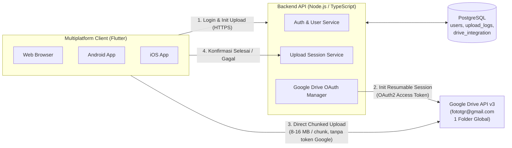
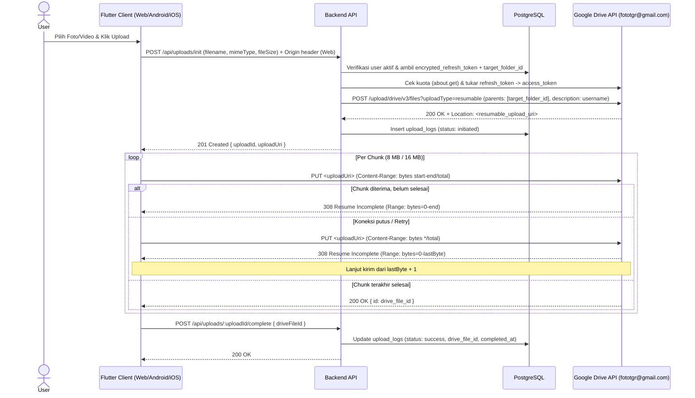

# Technical Design — Aplikasi Upload Foto & Video ke Google Drive (`tgr-drive`)

| Atribut | Detail |
| :--- | :--- |
| **Nama Produk** | TGR Drive Uploader (`tgr-drive`) |
| **Versi** | 1.1 |
| **Tanggal** | 23 November 2026 |
| **Dokumen Terkait** | [requirement.md](file:///d:/tgr-drive/docs/requirement.md) · [task.md](file:///d:/tgr-drive/docs/task.md) |

---

## 1. Tech Stack Multiplatform

| Layer | Teknologi | Alasan Pemilihan |
| :--- | :--- | :--- |
| **Client (Web, Android, iOS)** | **Flutter** (Dart) | 1 codebase untuk Web, Android, dan iOS; akses galeri/kamera native stabil (`image_picker` / `file_picker`); *chunked streaming upload* hemat RAM untuk video ukuran *unlimited*. |
| **Backend API** | **Node.js + TypeScript (Fastify / NestJS)** | Ringan, performa tinggi, SDK resmi Google (`googleapis`) sangat matang untuk OAuth2 & Drive API v3. |
| **Database** | **PostgreSQL (Aiven Cloud, `sslmode=require`)** + **Prisma / Drizzle ORM** | Relasional, managed cloud DB (`defaultdb`), mendukung `BIGINT` untuk ukuran file besar, transaksi ACID, dan query log/filter cepat. |
| **Enkripsi Token** | **AES-256-GCM** | Mengenkripsi `refresh_token` akun `fototgr@gmail.com` sebelum disimpan di database. |

> [!NOTE]
> **Alternatif Client:** Jika tim lebih memilih ekosistem JavaScript/TypeScript penuh, **Expo (React Native)** untuk Android/iOS + Web dapat menggantikan Flutter tanpa mengubah arsitektur backend, database, maupun API contract di bawah ini.

---

## 2. Arsitektur Sistem High-Level



### Mengapa Direct Resumable Upload?
Karena ukuran file **unlimited**, melewatkan file video melalui server backend (*proxy*) akan memicu:
- *Timeout* pada reverse proxy / load balancer.
- Konsumsi bandwidth ganda (Client -> Backend -> Google Drive) dan beban RAM/disk server.

Dengan **Direct Resumable Upload**, backend hanya meminta **Upload Session URI** sementara ke Google Drive API (untuk 1 file spesifik, tanpa menyertakan Access/Refresh Token), lalu klien mengirim *chunk* file langsung ke Google Drive.

---

## 3. Sequence Diagram: Direct Chunked Resumable Upload



### Catatan Teknis Khusus Platform
1. **CORS pada Web Browser:** Saat memanggil Google Drive API untuk inisiasi resumable session, backend **wajib** meneruskan header `Origin` dari browser klien (misal `https://drive.tgr.app`) agar Google Drive menyertakan header `Access-Control-Allow-Origin` pada `uploadUri`.
2. **Background Upload pada Android/iOS:** Gunakan mekanisme background task native atau simpan `uploadUri` + offset terakhir di penyimpanan lokal agar saat aplikasi kembali aktif, upload dapat langsung dilanjutkan via query `Content-Range: bytes */total`.

---

## 4. Integrasi Google Drive (`fototgr@gmail.com` — Google Pro 5 TB)

Karena `fototgr@gmail.com` adalah akun **Gmail personal dengan paket Google Pro (kapasitas 5 TB)** dan bukan Google Workspace Shared Drive:
- **Service Account tidak dapat digunakan** karena Service Account tidak memiliki akses ke kuota penyimpanan personal Google Pro 5 TB.
- **Mekanisme yang digunakan:** OAuth2 Authorization Code Flow dengan `access_type=offline` dan `prompt=consent` yang dilakukan **satu kali** oleh Admin menggunakan akun `fototgr@gmail.com`.
- **Scope OAuth2:** `https://www.googleapis.com/auth/drive` (dibutuhkan agar bisa menulis ke folder global yang sudah ada dan membaca informasi kuota 5 TB via `about.get`).
- **Penyimpanan Token:** `refresh_token` dienkripsi menggunakan `AES-256-GCM` dengan *master key* di environment variable server sebelum disimpan ke tabel `drive_integration`.
- **Google Cloud Console:** OAuth Consent Screen harus dipublikasikan ke status **Production** agar `refresh_token` tidak otomatis kedaluwarsa setelah 7 hari (batasan mode *Testing*).
- **Batas Kuota Harian Google Drive:** Google Drive membatasi total upload hingga **750 GB per 24 jam per akun**. Meskipun kapasitas penyimpanan 5 TB, sistem tetap harus menangani error `403 userRateLimitExceeded` dengan pesan yang jelas jika kuota harian tercapai.

---

## 5. Rancangan Database Schema (PostgreSQL)

### 5.1 Tabel `users`
```sql
CREATE TABLE users (
  id UUID PRIMARY KEY DEFAULT gen_random_uuid(),
  username VARCHAR(64) UNIQUE NOT NULL,
  password_hash TEXT NOT NULL,
  display_name VARCHAR(120) NOT NULL,
  role VARCHAR(16) NOT NULL CHECK (role IN ('admin', 'user')),
  is_active BOOLEAN NOT NULL DEFAULT TRUE,
  created_at TIMESTAMPTZ NOT NULL DEFAULT NOW(),
  updated_at TIMESTAMPTZ NOT NULL DEFAULT NOW()
);
```

### 5.2 Tabel `upload_logs`
```sql
CREATE TABLE upload_logs (
  id UUID PRIMARY KEY DEFAULT gen_random_uuid(),
  user_id UUID NOT NULL REFERENCES users(id) ON DELETE RESTRICT,
  original_filename TEXT NOT NULL,
  mime_type VARCHAR(128) NOT NULL,
  file_size_bytes BIGINT NOT NULL,
  drive_file_id VARCHAR(128),
  status VARCHAR(16) NOT NULL CHECK (status IN ('initiated', 'success', 'failed', 'cancelled')),
  error_message TEXT,
  created_at TIMESTAMPTZ NOT NULL DEFAULT NOW(),
  completed_at TIMESTAMPTZ
);

CREATE INDEX idx_upload_logs_user_created ON upload_logs (user_id, created_at DESC);
CREATE INDEX idx_upload_logs_status_created ON upload_logs (status, created_at DESC);
```

### 5.3 Tabel `drive_integration` (Singleton)
```sql
CREATE TABLE drive_integration (
  id SMALLINT PRIMARY KEY DEFAULT 1 CHECK (id = 1),
  google_email VARCHAR(255) NOT NULL,
  encrypted_refresh_token TEXT NOT NULL,
  target_folder_id VARCHAR(128) NOT NULL,
  updated_at TIMESTAMPTZ NOT NULL DEFAULT NOW()
);
```

---

## 6. Kontrak REST API (Backend)

### 6.1 Autentikasi
| Method | Endpoint | Akses | Deskripsi |
| :--- | :--- | :--- | :--- |
| `POST` | `/api/auth/login` | Publik | Login `username` + `password` -> kembalikan Access & Refresh Token (Cookie untuk Web / JSON untuk Mobile). |
| `POST` | `/api/auth/refresh` | Auth | Perbarui Access Token menggunakan Refresh Token. |
| `POST` | `/api/auth/logout` | Auth | Akhiri sesi pengguna. |
| `GET` | `/api/auth/me` | Auth | Ambil profil user yang sedang login. |

### 6.2 Upload & Riwayat (Uploader & Admin)
| Method | Endpoint | Akses | Deskripsi |
| :--- | :--- | :--- | :--- |
| `POST` | `/api/uploads/init` | Auth | Validasi format + cek kuota `fototgr@gmail.com` -> buat Resumable Upload Session -> kembalikan `{ uploadId, uploadUri }`. |
| `POST` | `/api/uploads/:id/complete` | Auth | Tandai upload berhasil + simpan `driveFileId`. |
| `POST` | `/api/uploads/:id/fail` | Auth | Catat kegagalan/pembatalan upload + `errorMessage`. |
| `GET` | `/api/uploads/history` | Auth | Daftar riwayat unggahan milik user sendiri (paginated). |

### 6.3 Panel Admin
| Method | Endpoint | Akses | Deskripsi |
| :--- | :--- | :--- | :--- |
| `GET` | `/api/admin/users` | Admin | Daftar seluruh user. |
| `POST` | `/api/admin/users` | Admin | Tambah user baru (`username`, `password`, `displayName`, `role`). |
| `PATCH` | `/api/admin/users/:id` | Admin | Ubah `displayName`, `role`, `isActive`, atau reset `password`. |
| `GET` | `/api/admin/drive/status` | Admin | Cek status koneksi `fototgr@gmail.com`, `targetFolderId`, dan sisa kuota penyimpanan. |
| `GET` | `/api/admin/drive/oauth-url` | Admin | Generate URL otorisasi OAuth2 Google untuk `fototgr@gmail.com`. |
| `GET` | `/api/admin/drive/oauth-callback` | Admin | Callback OAuth2: simpan `encrypted_refresh_token` ke database. |
| `PATCH` | `/api/admin/drive/folder` | Admin | Ubah `target_folder_id` global. |
| `GET` | `/api/admin/uploads` | Admin | Log unggahan seluruh user (filter `userId`, `status`, rentang tanggal). |

---

## 7. Keamanan & Mitigasi Risiko

| Risiko | Strategi Mitigasi |
| :--- | :--- |
| **Kuota 5 TB penuh atau limit harian 750 GB/hari tercapai** | Cek sisa kapasitas 5 TB via `about.get` sebelum membuat `uploadUri`, tampilkan indikator kapasitas di Panel Admin, dan tangani error `403 userRateLimitExceeded` dengan pesan informatif. |
| **Refresh Token OAuth kedaluwarsa** | Publish Google Cloud OAuth Consent Screen ke Production + sediakan tombol *Re-authorize* cepat di Panel Admin. |
| **Brute-force login** | Rate limiter (5x gagal / 15 menit) + hashing password `argon2`/`bcrypt` + pesan error login generik. |
| **Penyalahgunaan format file** | Whitelist MIME type & ekstensi foto/video di klien dan di `/api/uploads/init`. |
| **Upload video besar putus di mobile** | Chunked upload 8–16 MB + simpan `uploadUri` lokal untuk *resume* dari byte terakhir via HTTP `308`. |
